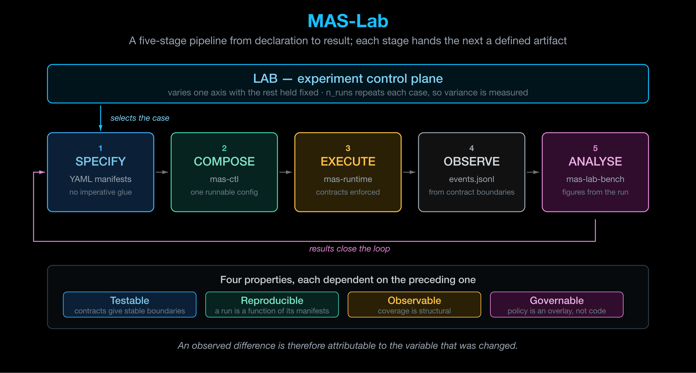

# MAS-Lab — Architecture

## Shape of the system

A five-stage pipeline from declaration to result, driven by an experiment control
plane. Each stage hands the next a well-defined artifact — manifests, a runnable
configuration, events, run artifacts, results. **Nothing is passed implicitly.**

## The five stages

| Stage | Owner | Input → Output |
|---|---|---|
| **1. Specify** | YAML manifests | Declarations → a complete specification |
| **2. Compose** | `mas-ctl` | Specification → a runnable configuration (compose, session, placement) |
| **3. Execute** | `mas-runtime` | Configuration → a running MAS, with contracts enforced at boundaries |
| **4. Observe** | Contract boundaries | Execution → `traces/events.jsonl` |
| **5. Analyse** | `mas-lab-bench` | Events → results, via a pipeline DAG |

### Stage 1 — Specify

Everything is a YAML manifest. There is no imperative glue.

Three variation axes are kept strictly separate, and the separation is what the
experimental claim rests on:

- **Flavours** — how the stack is built
- **Overlays** — what policy applies
- **Infrastructure bundles** — where it runs

!!! warning "Constraints on the variation axes"
    Model endpoints must not appear in overlays, and API URLs must not appear in
    flavours. Violating either collapses the separation between axes, and with it
    the attribution of an observed difference to the variable that was changed.

### Stage 3 — Execute

`mas-runtime` is a **Mealy kernel** enforcing contracts at boundaries, with a
three-category plugin ecosystem:

| Plugin category | Purpose |
|---|---|
| **Observability** | Emission at contract boundaries |
| **Governance** | Policy application as an overlay concern |
| **Infrastructure** | Placement and resource concerns |

### Stage 4 — Observe

Because events come from **contract boundaries**, coverage is structural. It does
not depend on anyone remembering to instrument a code path.

## The LAB control plane

`mas-lab benchmark run` executes all runs, then the pipeline. It nests four
levels, each supporting `pre:` and `post:` pipeline hooks:

| Level | Scope |
|---|---|
| **Application** | The whole experiment — infrastructure allocation, metric aggregation |
| **Scenario** | One overlay stack |
| **Test** | One dataset item across all runs |
| **Run** | One execution for a given (scenario, item, repeat index) → `traces/events.jsonl` |

`n_runs` repeats each (scenario, item) pair, so **variance is measured rather than
assumed** — which matters because LLM-backed agents are stochastic and a single
run proves nothing.

## Where the guarantees come from

Guarantees build across the three layers rather than resting on any one of them.

| | Source | What it covers |
|---|---|---|
| **By design** | The specification and the runtime | Declared roles, allowed tools, policy gates, execution mediation |
| **By validation** | Labs | Building blocks and compositions tested before promotion |
| **By observation** | Traces and guardrails | What only emerges under real workloads, latency and policies |

Four properties compound, each depending on the one before it:

1. **Testable** — contracts give stable boundaries to assert against.
2. **Reproducible** — the full configuration is resolved before execution, so a
   run is a function of its manifests.
3. **Observable** — events come from contract boundaries, so coverage is
   structural rather than a matter of instrumentation discipline.
4. **Governable** — policy is an overlay outside application logic, so it can be
   changed, audited and varied independently.

!!! note "The experimental claim"
    An observed difference is attributable to the variable that was changed rather
    than to uncontrolled variation elsewhere in the stack.

    The claim holds only while the three variation axes remain separated, which is
    why the constraints on mixing them — no model endpoints in overlays, no API URLs
    in flavours — are functional requirements rather than conventions.

## Packages

Dependencies layer strictly upward; there are no cycles.

| Layer | Package | Role |
|---|---|---|
| **Runtime** | `mas-runtime` | Mealy kernel, contracts, plugins, design patterns |
| **Orchestration** | `mas-ctl` | Compose, session, placement; chat, run-mas, validate |
| **Lab** | `mas-lab-core` | Shared contracts and telemetry |
| | `mas-lab-bench` | Benchmark execution and pipelines |
| | `mas-lab-controller` | Daemon with HTTP API |
| | `mas-lab-content` | Markdown rendering with directives |
| | `mas-lab` | Meta-package tying the above together |
| **Libraries** | `mas-library-standard` | Flavours, overlays, infra bundles, tools |
| | `mas-library-eval` | Evaluation metrics consumed by pipeline steps |
| | `mas-library-samples` | Community applications |

## Surfaces

- **`mas-ctl`** — CLI and TUI
- **Web UI** — overlay builder and run inspection, served by the controller
- **Controller HTTP API**

## Source material

- The MAS-Lab documentation — overview, user guide, packages and plugins reference, glossary
