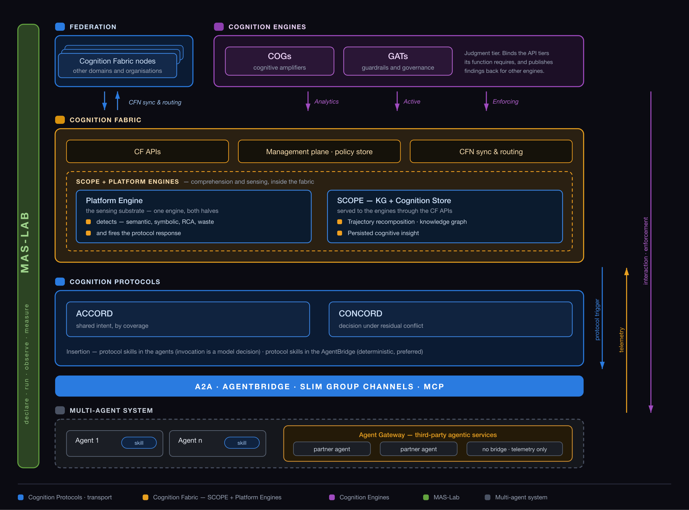

# Architecture

Three pillars and a validation layer across them

IoC rests on three pillars:

- The **Cognition Protocols**, which let agents reach a shared interpretation of the work.
- The **Cognition Fabric**, which records what happened and turns it into insight.
  **SCOPE** sits inside the fabric and supplies its comprehension layer.
- The **Cognition Engines**, which act on that insight to make the collective
  behaviour trustworthy and more capable.

**MAS-Lab** spans all three. It is not a fourth pillar but the environment in which
each of them is declared, executed, observed and measured.

Each section below covers one pillar: what it contributes, what it depends on
from the others, and where it sits in the picture. A final section covers MAS-Lab.

## 1. Cognition Protocols

Agreement

A **family** of protocols by which two or more autonomous agents — and the humans
among them — establish, maintain and validate **shared cognitive state**: shared
intent, shared meaning, and collectively validated agreement.

They run above an **L8** agent transport (A2A, MCP, carried over SLIM) that
guarantees messages arrive and are structurally well-formed. A Cognition Protocol's
unit of exchange is a fragment of an agent's own cognitive state, and its success
condition is not delivery but **convergence**: every participant ends the
exchange holding the same interpretation of what is being solved, in whose terms,
and what has been agreed.

**What it contributes.** Without the Cognition Protocols the other two pillars have
nothing to correct. The fabric can observe a disagreement and an engine can name it, but
only a protocol can re-open the question among the agents and close it again.

[:octicons-arrow-right-24: Cognition Protocols in detail](https://ioc-project.github.io/cognition-protocols/)

### How Cognition Protocols are inserted

Logically the Cognition Protocols sit above L8. The protocol ships as skills; the choice is where
they live, and it is a trade on determinism. The preferred route deploys them in
the [AgentBridge](https://shadi.agntcy.org/agentbridge/).

| Route | Invasiveness | Determinism |
|---|---|---|
| **Skills in the agents** | None — no code change | Weak — invocation is a model decision |
| **Skills in the AgentBridge** *(preferred)* | None — no recompile | Full on protocol mechanics; the agent's *use* of the result stays model-mediated |

The bridge is preferred because it is least invasive. The resolution is a split by
what must be deterministic: **the bridge owns the protocol machinery** (envelope,
sequence, phase barriers, merge, commit), while **the agent generates the message
payloads** — content generation could never have been deterministic under any route.

## 2. The Cognition Fabric

Memory and comprehension

A fabric that complements existing observability platforms to persist agentic
context and cognitive insights. **SCOPE** sits inside it and supplies the
comprehension layer: ingestion, normalization, the knowledge graph and the analysis
that fills it. The fabric owns the runtime and the contracts;
[SCOPE](https://ioc-project.github.io/scope/) owns what populates them.

Because a single agent's telemetry never contains the collective behaviour, the
fabric first **recomposes** the interaction:

1. normalize spans from every agent, tool and model call into one execution model;
2. reconstruct the multi-hop trajectory under a single session identity;
3. build a knowledge graph of agents, transitions, tasks and concepts.

That recomposed object, not the raw trace, is what cognitive analysis runs on —
semantic grouping, anomaly and consistency checks, normal-behaviour baselines,
impact assessment. What comes out is **consolidated cognitive insight**, persisted
in the **Cognition Store** alongside the context it was derived from.

**What it contributes.** Persistence is what makes the system compounding rather
than episodic. One engine's conclusion becomes another's input, and understanding
accumulates across sessions instead of resetting with every interaction.

### The three API tiers

The fabric exposes exactly three surfaces, in increasing order of intrusiveness.
An engine's capability is determined entirely by which tiers it binds.

| Tier | Engines can | Engines cannot | In-path component |
|---|---|---|---|
| **Analytics** (read-only) | Query trajectories, LLM, tool and protocol records, semantic metrics, prior findings | Send messages, invoke tools, block anything | **None** |
| **Active** (interactive) | Send messages into a protocol interaction, query MAS tools, participate as an active party | Block, modify or inject in-flight | **None** |
| **Enforcing** (control) | **Block**, **modify**, **inject** on live protocol messages and tool calls | Enforce without an in-path component | **In-path component required** |

The fabric owns the API contract and the routing. The Enforcing tier additionally
requires a component in the traffic path, since blocking, modifying or injecting a
live message cannot be done from outside it.

The **AgentBridge** can serve that role. Already deployed as a declared endpoint for
protocol execution, it sits at the MAS boundary and can equally apply an engine's
decision to the live interaction.

## 3. The engines

Judgment

Both engine classes read through the fabric's analytics tier and publish their own
findings back. They can be simple or complex, deterministic or probabilistic, and
are sometimes agentic themselves.

**Platform Engines (PEs)** are the sensing substrate, and they close the protocol loop.
They analyse recomposed trajectories for cognitive failures — named by function
and locus, attributed to the originating event — and turn a detected failure into
a trigger that re-opens alignment among the agents while the session is still
running.

**Cognition Engines (CEs)** bring higher-level capability:

- **GATs (Guardrail Technologies)** enforce security, cost and compliance
  constraints — semantic segmentation, CASA continuous agent semantic
  authorization, detective investigation.
- **COGs (Cognitive Amplifiers)** accelerate collective problem-solving — shared
  memory curation, cost optimization. *No COG deliverables exist yet.*

COGs address the effectiveness of collaboration; GATs address its
trustworthiness.

**What they contribute.** An engine that can only report leaves the loop open.
Binding the Active or Enforcing tier is what lets a finding change what the MAS
does next, rather than only describing what it already did.

## 4. MAS-Lab, across all three

Measurement

MAS-Lab is not a further pillar. It spans the other three: any component described
above can be declared, executed, observed and measured inside it.

A multi-agent system is declared as versioned YAML manifests, composed into a
runnable configuration, executed under contracts enforced at every boundary, and
observed through events emitted at those contract boundaries. Policy and
experimental variation are applied as overlays outside the application logic, so a
single factor can be varied with the rest held fixed.

**What it contributes.** Every claim made on this site about a protocol, an engine
or the fabric is measured here against a matched baseline. Without it, those claims
would be assertions. The measured results reported under
[Cognition Protocols](https://ioc-project.github.io/cognition-protocols/evaluation/) were produced
this way.

[:octicons-arrow-right-24: MAS-Lab in detail](../mas-lab/index.md)

## How it composes end to end

For a single governed interaction:

1. A MAS runs. Its agents talk over **L8** (A2A / MCP / SLIM). **Cognition Protocols** ride above,
   inserted via the AgentBridge, establishing shared intent and validated agreement.
2. Telemetry leaves via any OTel instrumentation, normalized by a **SCOPE schema adapter**.
3. **SCOPE** ingests it, reconstructs trajectories, builds the knowledge graph and emits **Insights**.
4. **Platform Engines** analyse those trajectories for cognitive failures and **trigger Cognition Protocols** to re-align — the loop closing on itself.
5. **CF** holds the enriched model and the **Cognition Store**, and exposes **Analytics / Active / Enforcing**.
6. **CEs** bind the tiers their function requires, and publish findings back to the store.
7. When an engine needs to *act*, an in-path component such as the AgentBridge applies the decision to the live interaction.
8. **MAS-Lab** measures whether any of this actually improved coordination.

## Explore interactively

An interactive view mapping the architecture onto four deployment scenarios —
from a single environment to a federation across enterprises — is published
alongside this site.

[:octicons-arrow-right-24: Open the architecture explorer](/explorer/)
