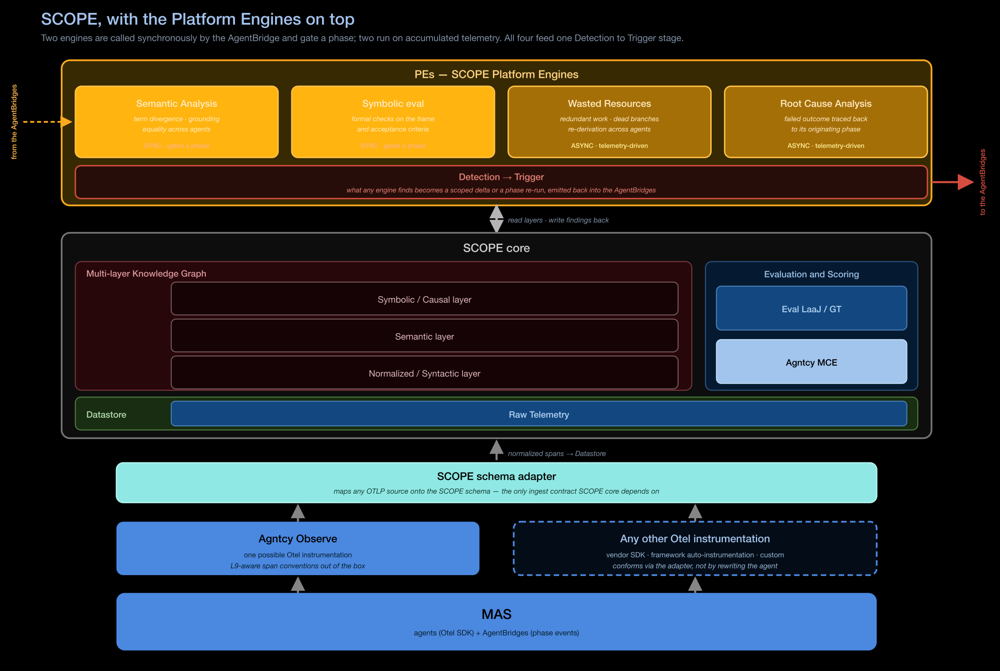

# SCOPE — Analysis Engines

Two families of engines contribute to what the platform produces. What sets them
apart is their purpose, not where they sit.

- **[KG-enrichment engines](#kg-enrichment-engines)** build the knowledge-graph
  layers, as workers on the ingestion pipeline or on a periodic schedule.
- **[Platform Engines (PEs)](#platform-engines-pes)** read those layers, name the
  cognitive failures in them, and decide whether to **re-open a Cognition Protocol**.

## Why they exist

Multi-agent cognitive failures originate in breakdowns that infrastructure
monitoring cannot see. Once agents coordinate, the environment in which cognition
takes place is transformed: agents adopt inconsistent abstractions or naming
conventions, beliefs fragment across asymmetric evidence, and summaries become
contradictory.

These semantic and epistemic divergences propagate into failures of coordination
and collective reasoning — misaligned plans, incomplete reasoning chains — that
are **invisible to latency or throughput metrics** and emerge from interactional
dynamics distributed across the team.

Grounded in distributed cognition and shared mental models, the failures organise
along two axes:

- the **cognitive function** whose breakdown produces the failure;
- the **locus** at which it becomes observable.

That **Locus × Function** taxonomy is the foundation for what the engines detect
and surface.

## What the engines evaluate

Agentic evaluation goes beyond traditional operational metrics. Error rates, cost,
duration and latency describe execution; they say nothing about whether an answer
was grounded in real data, whether instructions were followed, or whether the
reasoning that produced it was sound.

There are three ways to evaluate an agentic conversation, and SCOPE supports all
three:

| Method | When it applies |
|---|---|
| **Ground-truth comparison** | A user-provided expected answer exists and is comparable |
| **Application-specific heuristics** | A domain-specific answer can be validated by rule |
| **LLM-as-a-Judge** | Neither of the above applies, which is the common case |

### Three pillars

Evaluation is organised into three pillars. Each is answerable on its own, and
semantic analysis strengthens each of them.

| Pillar | The question it answers | Base method | What semantic analysis adds |
|---|---|---|---|
| **Quality** | Was the answer correct, grounded, relevant and on-task? | Ground-truth comparison, heuristics, LLM-as-a-Judge | A metric dependency tree, so expensive judgements run only where cheaper ones leave doubt |
| **Reliability** | Does the system behave consistently on similar queries? | Active probing | Semantic grouping and consistency analysis |
| **Performance** | Was the reasoning process optimal? | LLM-as-a-Judge, cost | Semantic trajectory analysis |

!!! note "Why the pillars need semantic analysis"
    Agentic applications are stochastic: the same question can produce different
    outcomes. Judging a single session in isolation cannot distinguish acceptable
    variation from a failure. Semantic analysis supplies the comparison set by
    identifying which sessions are **expected to behave similarly**.

### Reliability

Reliability is the degree of variability within a session's semantic group. It is
measured on three axes rather than one, because they diverge:

- variance of scores,
- dispersion of responses,
- graph edit distance across execution graphs.

A session can be reliable on accuracy, moderately reliable on its execution graph,
and unreliable on its textual response. Reporting a single reliability number would
conceal that.

### Performance

Performance assesses the **optimality of the reasoning process** rather than the
answer: identifying failures, reasoning loops and suboptimal trajectories by
comparing a session's execution path against others in its group.

### Cost control

LLM-as-a-Judge metrics are expensive, so two mechanisms keep evaluation affordable:

- **Metric hierarchies** — metrics are arranged in a dependency tree, so a
  downstream judgement is computed only when the metric above it leaves the
  question open.
- **Stateful and trajectory evaluation** — intent, groundedness and relevance are
  carried as trajectory state across steps rather than recomputed at each one.

## KG-enrichment engines

These ship in SCOPE today. See [Architecture](architecture.md#the-ingestion-pipeline)
for more information.

| Worker | When | What it does |
|---|---|---|
| **norm** | Ingestion | Maps spans onto the MAS execution ontology; reconstructs the trajectory under a single session identity |
| **embedding** | Ingestion | An embedded vector for each state in the trajectory |
| **mce** | Ingestion | The configured metric set for the session — quantitative and LLM-judged |
| **grouping** | Ingestion | Assigns the session to a semantic group, using the embeddings |
| **analysis** | Ingestion | A bundle of three analyses run together over the assigned group — **anomaly detection** (outlier sessions within the group), **consistency** (contradiction between agent contributions) and **normal behaviour** (the baseline anomaly detection scores against). Reached only if grouping could assign the session to a group |
| **stateful-eval** | Ingestion | Temporal and stateful metric computation over the trajectory |
| **hierarchical grouping** | Periodic | Builds and rearranges the semantic-group hierarchy as sessions arrive |
| **intelligence** | Periodic | Derives insights from the KG from a catalog's templates |

`mce` and `stateful-eval` are also the evaluation surface that
[MAS-Lab](../mas-lab/index.md) uses to measure the Cognition Protocols.

!!! note "Semantic grouping is a prerequisite, not a feature"
    Normal behaviour cannot be defined for a multi-agent system in general, only
    within a set of sessions expected to behave alike. Grouping therefore has to
    run before anomaly detection, reliability and wasted-resource analysis can mean
    anything. It also produces a **topic hierarchy**, which is what makes a question
    such as *how is the travel agent behaving on refund requests* answerable by
    filtering rather than by search.

## Platform Engines (PEs)

**PEs are the sensing substrate.** They produce a consumable stream of cognitive
signals — failures named by function and locus, attributed to the exact source
event — that Cognition Protocols consume to trigger alignment.

Five engines perform analysis and detection, and they split by *when* they run.

### Synchronous — gates a phase

These run inside the protocol control loop and can hold a phase barrier.

| Engine | Role |
|---|---|
| **Semantic Analysis** | Term divergence, grounding, equality across agents. Analysis based on semantic groups and (ab)normal behaviour modelling |
| **Symbolic Evaluation** | Formal checks on the frame and acceptance criteria; symbolic trajectory evaluation |

### Asynchronous — telemetry-driven

These run off the hot path, against what the pipeline has already produced.

| Engine | Role | Status |
|---|---|---|
| **Wasted Resources** | Redundant work, dead branches, re-derivation across agents — adapted to protocol overhead | **Planned** |
| **Error localization / RCA** | Attributing a failed outcome back to its originating event and phase | **Planned** |

### The trigger

| Engine | Role |
|---|---|
| **Detection → Trigger** | Cognitive observability: classifies incoming signals and fires the appropriate protocol response |

This engine closes the Core loop. It consumes the signals the other engines produce
and, for each named failure, triggers the matching protocol response so that the agents
re-open alignment while the session is still running. It also writes its findings
back into the graph.

!!! warning "Draft — to be completed"
    Per-engine detection thresholds, the full Locus × Function taxonomy table, and
    the signal schema the trigger emits are not yet reproduced here.

