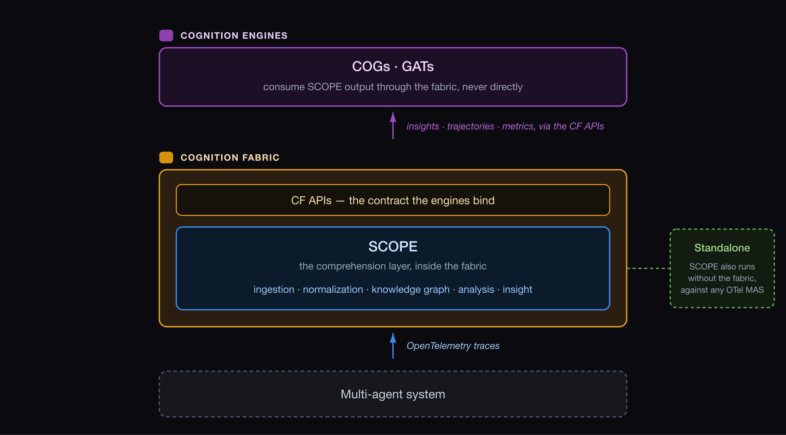
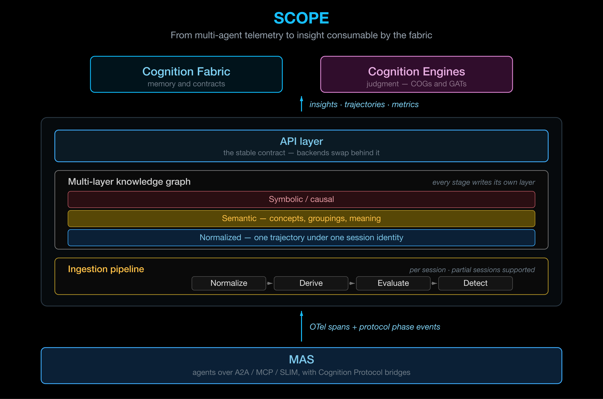

# System for Cognitive Observability Provenance and Explainability (SCOPE)

The comprehension layer

**SCOPE is a modular platform for observing, analysing and explaining multi-agent
system executions from OpenTelemetry traces.** It ingests raw OTel spans,
maps them onto a shared MAS ontology, and enriches each session with semantic grouping,
anomaly detection, consistency checking and stateful trajectory
evaluation. It also enriches each session with **cognitive observability**, used to detect cognitive failures within a session.
All of this is surfaced through an API and a web dashboard.

Its objective is to turn multi-agent telemetry into explainable, actionable and
controllable operations at enterprise scale. That decomposes into three functions:

| | Function |
|---|---|
| **1. Observe** | Reconstruct what the multi-agent system actually did, across agents, tools, memory and workflows |
| **2. Explain** | Turn telemetry into analysis, anomaly detection and trajectory intelligence, with a clear account of what to fix, optimise or watch next |
| **3. Recommend** | Turn that account into actionable remediation, so agentic systems can run safely and reliably in production |

SCOPE is released as **open source** software under the Apache 2.0 license, at
[`ioc-project/ioc-scope`](https://github.com/ioc-project/ioc-scope).

## Positioning

Within IoC, SCOPE sits **inside the Cognition Fabric** and supplies its comprehension
layer. The division of responsibility is that the fabric owns the runtime and the
contracts, and SCOPE owns the ingestion and analysis that populate them.

The **Cognition Engines** do not read SCOPE directly. They bind the CF API tiers, and
the fabric serves SCOPE's output — insights, trajectories and metrics — through
them.

SCOPE can also be **deployed standalone**, independently of the rest of IoC. It has
its own repository, lifecycle and release cadence, and operates against any MAS
emitting OpenTelemetry traces without requiring the Cognition Fabric, the Cognition
Protocols or any other IoC component.

[:octicons-arrow-right-24: Deployment modes](../how-to/index.md#the-three-modes)

## How a session flows through it

1. A MAS emits **OTel spans** to an OTel collector, which then sends it to a database, by default an instance of
ClickHouse DB, but it can be replaced by another one.

2. Once the trace is complete, the **ingestion pipeline**, a collection of workers, is triggered.
First, the normalisation worker maps the raw spans onto
   the [MAS ontology](#the-ontology), producing a structured execution model.
3. Then, the session is enriched by the **analysis workers** — semantic grouping,
   anomaly detection, consistency checking, stateful evaluation, and metrics, computed through the MCE
   (Metrics Computation Engine).
4. The enriched **knowledge graph** is served through the API and visualised in
   the UI, and read by Cognition Engines through the fabric.

## Why OpenTelemetry alone is not enough

OpenTelemetry is optimised for collection and storage, not for reasoning about a
multi-agent execution. Raw spans arrive with four properties that make them
unusable as an analysis substrate:

| Property | What it means |
|---|---|
| **Heterogeneous** | Different frameworks and SDKs describe the same construct differently |
| **Incomplete** | The relationships that constitute collective behaviour are not recorded by any single agent |
| **Not queryable** | There is no structure to ask questions of beyond the span tree |
| **Inconsistent** | The same field carries different meanings across emitters |

Semantic conventions improve this only partially. Three gaps remain — **structure**,
**temporal** and **semantic** — and closing them is the function of normalization
and the ontology below.

## The ontology

The ontology is what makes the analysis composable: every worker reads and writes
nodes defined by it, rather than re-deriving structure from raw spans.
Five bundled ontologies share a single namespace.

| Ontology | Holds |
|---|---|
| **MAS** | The core execution schema — structural types (MAS, Agent, LLM, Tool, Processing), their execution instances, and the normalized State/Transition trajectory |
| **Metrics** | The Metric/MetricResult definition–observation split, score nodes, templates |
| **Semantic** | The embedding layer linking State and Execution nodes to embeddings |
| **Analysis** | Group-scoped analysis reports — consistency, anomaly, normal behaviour |
| **Insight** | Rendered, catalog-templated insights attached to a target graph node |

The ontology is published, along with documentation and visualisation at [ioc-project.github.io/ioc-scope/ontologies](https://ioc-project.io/ioc-scope/ontologies.html)

## Instrumentation is not mandated

**The requirement is OpenTelemetry, not a specific SDK.** Any MAS emitting
semantic-convention-compliant spans can be ingested.

The reference instrumentation is the
[AGNTCY Observe SDK](https://github.com/agntcy/observe) — `ioa_observe_sdk` —
which decorates agent, tool and workflow functions and emits spans to an OTLP/HTTP
collector. **SCOPE itself is not installed in the agent application.** Vendor SDKs,
framework auto-instrumentation and custom emitters are all admissible, as are the
boundary-level traces propagated in black-box mode.

!!! warning "Fidelity tracks instrumentation richness"
    Fields that are not convention-compliant are inferred on a best-effort basis,
    and black-box traces arrive with materially less semantic content than
    SDK-instrumented ones — so analysis coverage is wider where instrumentation is
    richer. What does **not** vary is the ingestion contract.

!!! note "Two modes of span ingestion"
    The ingestion pipeline, and more precisely the normalisation worker, supports two modes.
    Spans can either be ingested when a **session-completion notification** is received; or
    spans are ingested as they arrive in a near real-time fashion, providing real-time support
    for the knowledge graph.

## Datastores are implementation, not architecture

SCOPE is agnostic to the databases behind the knowledge graph and the telemetry store.
Upstream clients see a stable API, so a backend can be replaced without changing what consumers see.

That agnosticism is also the **adoption path**: rather than requiring an
enterprise to stand up SCOPE's own stack, SCOPE can integrate with the observability
platform and databases a customer already runs, and contribute the cognitive layer on top of them.

## In this section

-   **[Architecture](architecture.md)** — the pipelines, the graph, the boundary with CF.
-   **[Platform](platform.md)** — intake, stores, API layer, deployment.
-   **[Analysis Engines](analysis-engines.md)** — what each analysis does, and the Platform Engines they feed.

## Source material

- [`ioc-project/ioc-scope`](https://github.com/ioc-project/ioc-scope) — SCOPE repo, under Apache 2.0 license.
- [Ontology documentation](https://ioc-project.github.io/ioc-project/ioc-scope/ontologies)
- [AGNTCY Observe SDK](https://github.com/agntcy/observe) — the reference instrumentation
